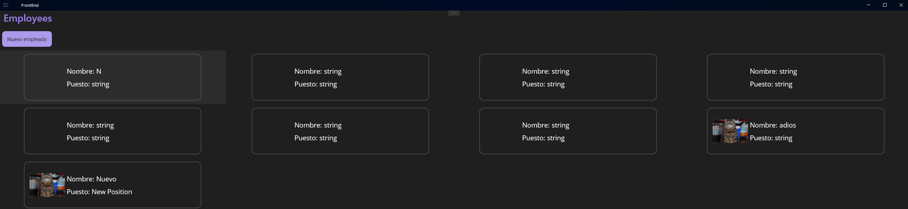
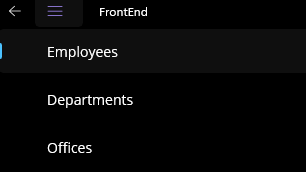
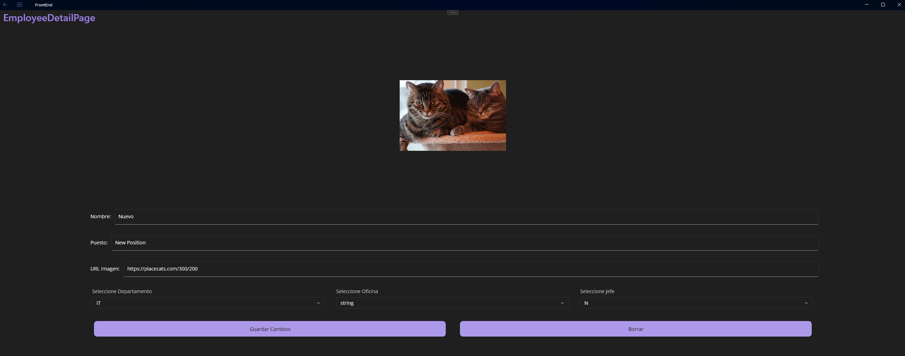

# Employee Administration App

> Application for administrating employees

Small application for administrating employees, offices and departments, and relating eachother. Used with the [employee administration API](https://github.com/goldhammer375/FastAPI_EmployeeAdministration)

## Installation

You only need to generate the desired executable, depending on the platform and architecture you are working on. Because it is made using .NET MAUI, the following platforms are supported:

* Windows

* MacOS

* Android

* iOS

## Usage eample

You can change pages to administrate employees, departments and offices.

If you select a card, you will go to a detail view of the selected item, where you can update it, or delete it. Also, you can make relationships between eachother, for linking the employees with their department, office or boss.

You can do the same with the offices and departments.
